# Hub-and-Spoke Authentication: Learn It, Run It, Break It

A hands-on learning project for one of the most useful patterns in B2B SaaS identity: **hub-and-spoke identity federation**. Many customers each log in with their own company login (Azure AD, Okta, Google Workspace), and many apps and environments need to trust those logins, without anyone configuring `customers × apps` separate connections.

This repo has three parts that teach the same design from three angles:

| Part | What it is | Run it |
|---|---|---|
| [**Playground**](auth-hub-playground/) | An interactive web UI. Step through a login hop by hop, read each token, break things, take a quiz. | `bun run dev` |
| [**Lab**](auth-hub-lab/) | A real, runnable Python implementation: signed JWTs, OIDC authorization-code flow, four layers, live trace console. | `uv run authlab` |
| [**Notes**](docs/auth-hub-spoke.md) | Interview-style study notes: requirements, trade-offs, failure modes, exercises. | read |

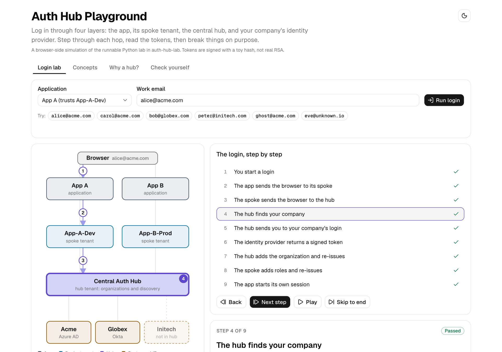

---

## The idea in 30 seconds

- Each **customer** keeps its own login system, called an *identity provider* (IdP).
- One central **hub** knows every customer and where to send them to log in.
- Each **app environment** (a *spoke*) trusts **only the hub**.
- To add a customer you change **one thing**: the hub. No app is touched.

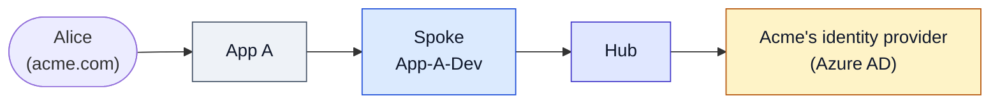

---

## 1. The problem: every app needs every customer

Say you sell 3 apps, each in 3 environments (dev, stage, prod), to 50 customers. If each app environment connects directly to each customer's login system:

```text
connections to build and maintain = customers × app environments
                                  = 50 × 9 = 450
```

Each connection has its own secrets to rotate, and signing up customer #51 means changing all 9 app environments. Here is the same problem at toy size, 3 customers and 3 app environments:

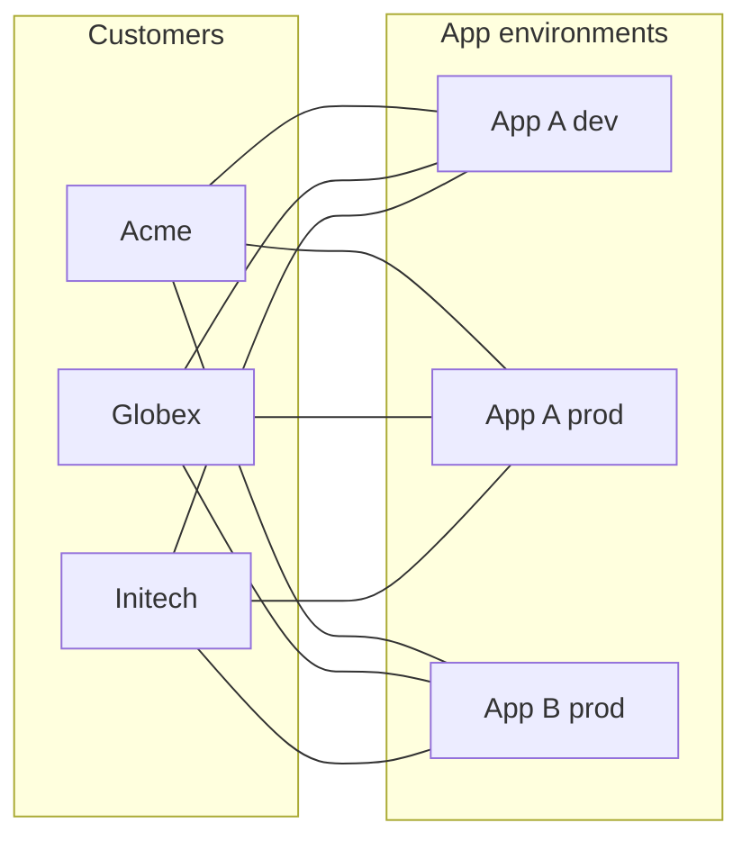

**9 connections.** Add one customer and you add 3 more. Add one app environment and you add 3 more. It grows by multiplication.

## 2. The answer: put a hub in the middle

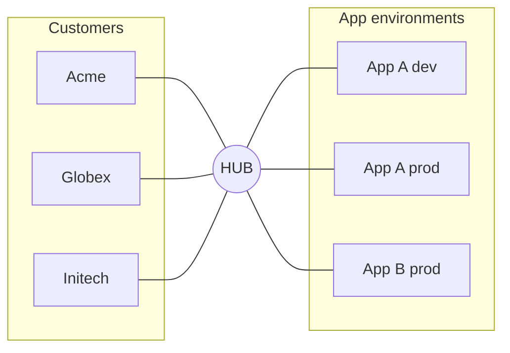

**6 connections** (3 + 3). It grows by addition: `customers + app environments`. For the 50-customer example that is **59 instead of 450**. The playground's *Why a hub?* tab lets you drag the sliders and watch the numbers diverge.

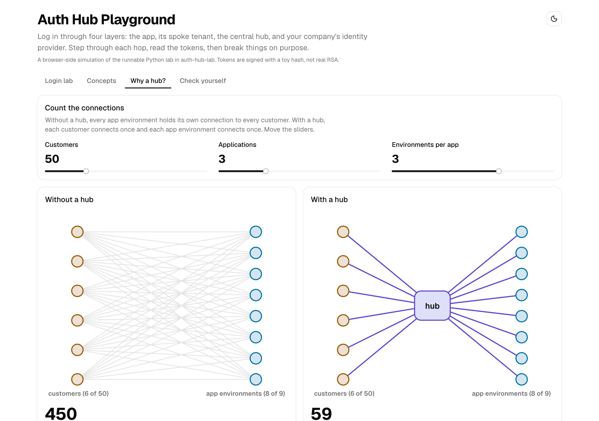

## 3. The four layers

Everything is one of four things. Each layer trusts only the layer directly above it in this picture (the one it asks to prove identity).

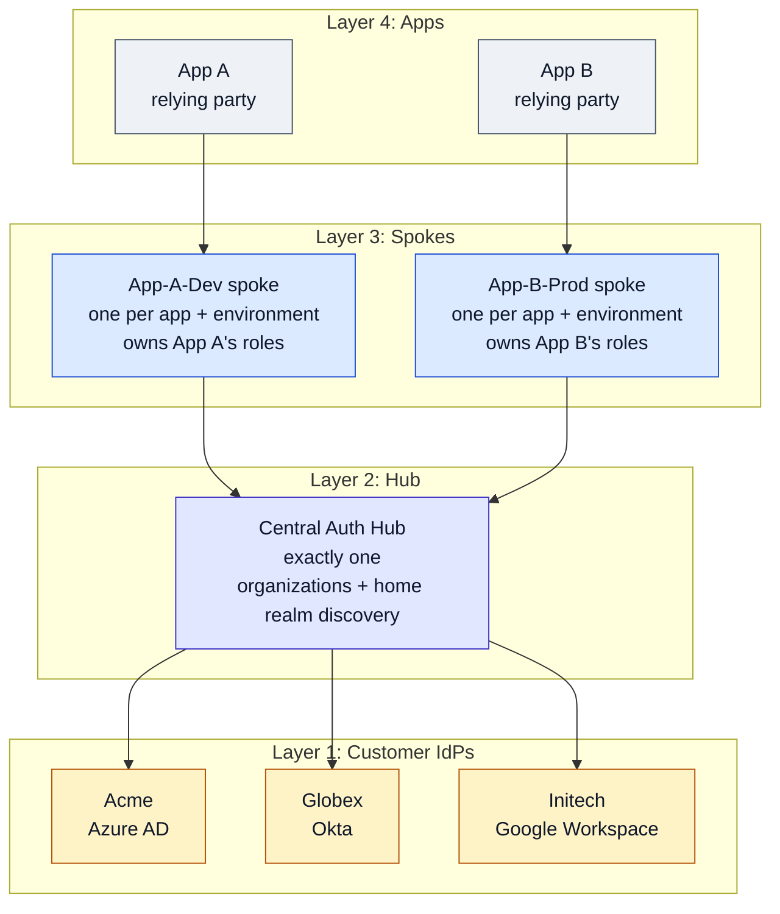

| Layer | Knows about | Does |
|---|---|---|
| **Identity provider** | Its own employees and their passwords | Proves who a person is. Nobody else ever sees the password. |
| **Hub tenant** | Every customer: email domain, which IdP, which organization | Home realm discovery. Adds the customer's identity (`org_id`, `org_name`) to the token. |
| **Spoke tenant** | One app environment; its only upstream is the hub | Adds that app's **roles**. Trusts one issuer: the hub. |
| **Application** | Its own session | Trusts its spoke. Never talks to a customer IdP. |

The pattern is general. The playground and notes use Auth0 vocabulary (tenants, organizations, enterprise connections) because that is where it is most commonly built.

## 4. What happens during one login

Alice at Acme opens App A. Notice that the app never talks to Acme directly, and Alice's password only ever goes to Acme.

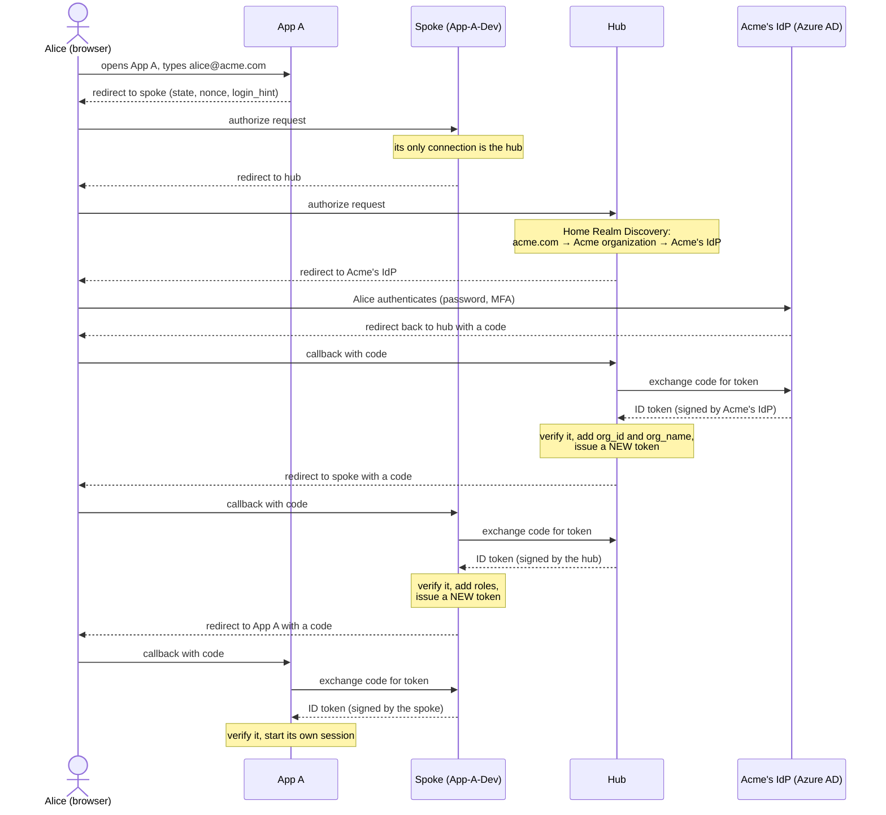

The playground compresses this into nine hops you can step through. For each one it shows who does the checking, what is checked, and what gets added to the token:

| # | Hop | Checked by | What is checked | Added to the token |
|---|---|---|---|---|
| 1 | You type your work email in App A | Browser | nothing yet. App A keeps no passwords. | |
| 2 | App → spoke | Spoke | `client_id` is registered; `redirect_uri` matches exactly | the app sends `state`, `nonce`, `login_hint` |
| 3 | Spoke → hub | Hub | hub is reachable; this spoke's hub client is registered; `redirect_uri` matches | |
| 4 | Hub finds your company | Hub | an organization is registered for the email's domain | |
| 5 | Hub → your company's login | Customer IdP | the hub is a registered client; the IdP has an account for this email | |
| 6 | IdP returns a signed token | Hub | signature, `iss`, `aud`, `nonce`, `exp` | `email`, `name` (by the IdP) |
| 7 | Hub re-issues | Spoke | signature, `iss`, `aud`, `nonce`, `exp` of the hub's token | `org_id`, `org_name` (by the hub) |
| 8 | Spoke re-issues | App | `state`, then signature, `iss`, `aud`, `nonce`, `exp` of the spoke's token | `roles` (by the spoke) |
| 9 | App starts a session | App | claims accepted; a session cookie is set (roles are a snapshot from login) | |

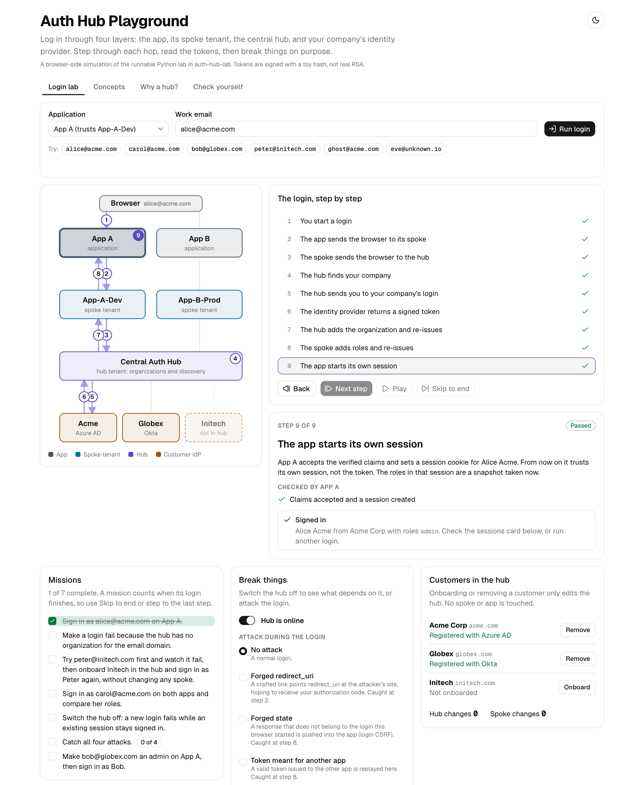

## 5. Why every hop issues a *new* token

It would be simpler for the app to accept Acme's token directly. It would also be a mistake, because then every app would have to trust every customer's IdP, keep their signing keys up to date, and understand their claim formats.

Instead each layer verifies **one issuer** and mints a token for **one audience** (`aud`):

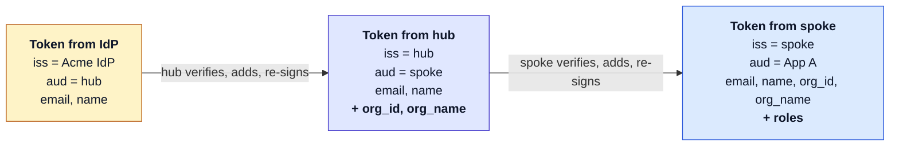

Two things follow. A token stolen from one app is useless at another (wrong `aud`). And each layer owns its own facts: the IdP knows who you are, the hub knows which customer you belong to, the spoke knows what you may do in that app.

## 6. Onboarding a customer without touching any app

This is the payoff. Initech is not in the hub yet, so Peter cannot log in. One change in the hub fixes it, and the same login then works for every app and environment.

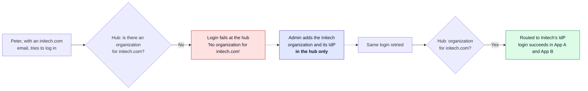

You can do this yourself: it is mission 3 in the playground, and the lab does it with a single `curl` against the hub's admin endpoint (see the [lab README](auth-hub-lab/README.md)).

## 7. What the design buys

- **Write once.** A new customer is one change in one place.
- **One trust anchor per spoke.** A spoke validates one issuer and rotates one set of credentials.
- **Isolation.** Every spoke has its own client in the hub, so a leaked dev secret exposes one hub client, not customer connections and not production.
- **Authorization stays local.** Roles live in the spoke, so the same person can be an admin in one app and a viewer in another. (In the playground, Carol is exactly that.)

## 8. What it costs

Honest trade-offs are the part interviewers care about most.

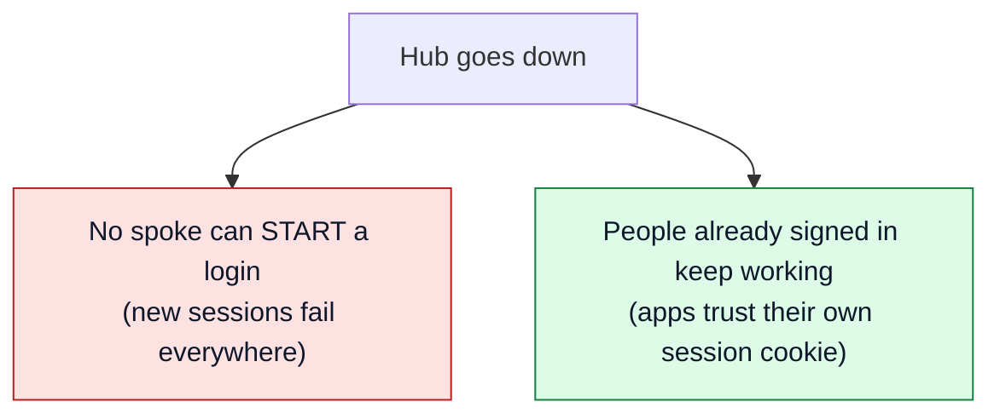

- **The hub is a single point of failure for new logins.** Existing app sessions survive until they expire. You must plan its availability, caching and regional failover. The playground lets you switch the hub off and see this (mission 5).
- **More hops mean more latency** and more places for a login to fail.
- **Dev environments may see real identities** if dev spokes federate to production customer IdPs. Teams often present that as a convenience. It is also a compliance question.
- **Claim names are a contract.** If the hub renames `org_id`, every spoke can break.
- **Logout does not propagate.** Ending the app session does not end the spoke, hub or IdP sessions.

## 9. Security checks you can watch fail

Each of these is implemented in the Python lab, covered by its tests, and attackable in the playground's *Break things* panel.

| Check | Where | Defends against |
|---|---|---|
| Exact `redirect_uri` match | hub, spoke, IdP | Stolen authorization codes |
| `state` round-trip | app, brokers | Login CSRF (a response from someone else's login) |
| `nonce` inside the ID token | each hop | Token replay |
| Signature, `iss`, `aud`, `exp` | every verifier | Forged or misdirected tokens |
| Single-use, short-lived codes | each provider | Code replay |
| Client secret on the token call | each provider | Someone who intercepts a code |
| A separate hub client per spoke | hub | A dev leak affecting prod |

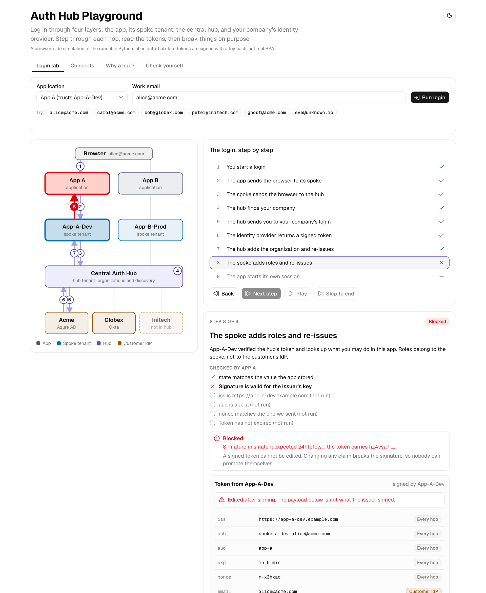

## 10. Words that trip people up

| Term | Plain meaning |
|---|---|
| **Identity provider (IdP)** | The system that checks who a person is: the customer's Azure AD, Okta or Google Workspace. |
| **Relying party** | Anything that trusts an IdP's proof instead of checking passwords itself. Here the hub trusts IdPs, spokes trust the hub, apps trust spokes. |
| **Tenant** | An isolated container with its own users, connections, apps and signing keys. The hub is one; each spoke is another. |
| **Organization** | A container in the hub for one customer: its connection and verified email domain. |
| **Home Realm Discovery** | Choosing the right IdP for a user, usually from their email domain. |
| **Claims** | Facts in a token (`email`, `org_id`, `roles`). |
| **Spoke vs scope** | A *spoke* is a tenant in this design. An OAuth *scope* (`openid email profile`) is a list of data a client asks for. Unrelated. |

---

## Try it

### The playground (interactive UI)

Requirements: [Bun](https://bun.sh).

```bash
cd auth-hub-playground
bun install
bun run dev        # http://localhost:3000
bun test           # engine and mission tests
```

Four tabs: **Login lab** (step through a login, break things, seven missions), **Concepts**, **Why a hub?** and **Check yourself** (a quiz). It is a browser-side simulation of the Python lab, so no backend is needed. Built with Bun, Next.js, Tailwind and shadcn/ui. See its [README](auth-hub-playground/README.md).

### The lab (a real implementation)

Requirements: [uv](https://docs.astral.sh/uv/).

```bash
cd auth-hub-lab
uv sync
uv run authlab     # console at http://localhost:9300
uv run pytest      # end-to-end tests
```

Nine local services run together: three simulated customer IdPs, the hub, two spokes, two apps, and a console that shows every redirect and token hop live. No Auth0 account, Docker or internet needed. See its [README](auth-hub-lab/README.md) for the study workflow and the `curl` that onboards Initech.

### The notes

[`docs/auth-hub-spoke.md`](docs/auth-hub-spoke.md) works through the design the way an interview would: problem, scope, questions to ask, assumptions, architecture, trade-offs, security, failure modes, exercises, and a script for explaining it out loud.

## Repository layout

```text
.
├── README.md                  you are here
├── docs/
│   ├── auth-hub-spoke.md      study notes
│   └── images/                screenshots used in this README
├── auth-hub-lab/              Python implementation (Flask, PyJWT, pytest)
└── auth-hub-playground/       interactive UI (Bun, Next.js, shadcn/ui)
```

## Limits, and where this could go

This is a teaching project, not production code.

- Tokens in the playground use a toy hash, not RSA. The Python lab uses real RS256 JWTs, but keys live in memory and never rotate.
- No PKCE, refresh tokens, single logout, or rate limiting.
- The Auth0-specific features (Organizations, Actions, Management API) are *modeled*, not used. Check the Auth0 docs before relying on any detail about how they behave.
- All secrets in the lab (`demo-secret-…`, `demo-hub-admin-token`) are fake, hard-coded demo values.

Ideas for next steps:

- Kill the hub mid-session and record what still works; rotate a signing key and handle a stale JWKS; add PKCE and single logout (open milestones M6 to M8 in the lab README).
- **Service-to-service (machine-to-machine) calls.** There is no user in that flow, so it skips the hub and its home realm discovery entirely. The interesting design question is how to keep customer isolation when one spoke's service calls another spoke's API: the token needs to carry a customer identifier that both sides agree on, ideally a neutral `customer_id` you own rather than a vendor-generated id.

## Disclaimer

An independent learning project. It is not affiliated with or endorsed by Auth0, Okta, Microsoft, Google or any other vendor named here. Company names such as Acme, Globex and Initech and all emails are fictional examples.

## License

[MIT](LICENSE)
